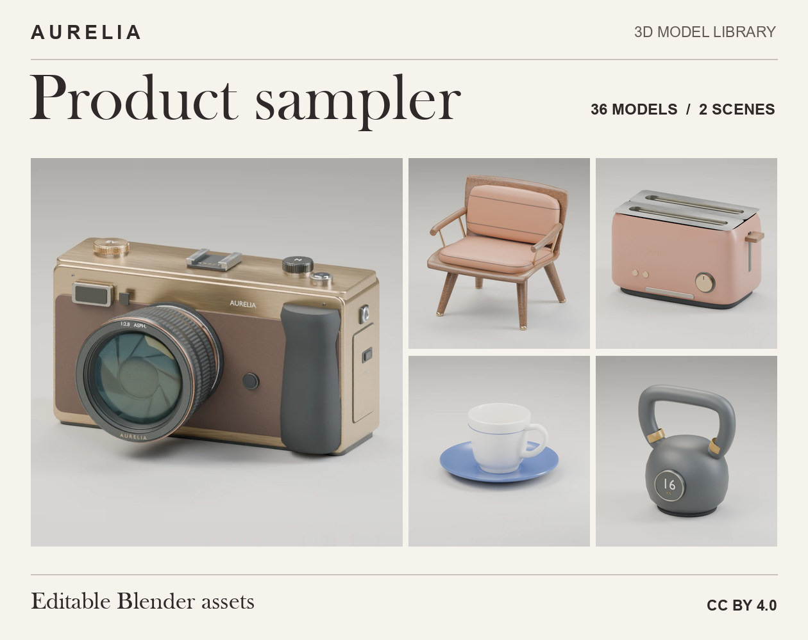
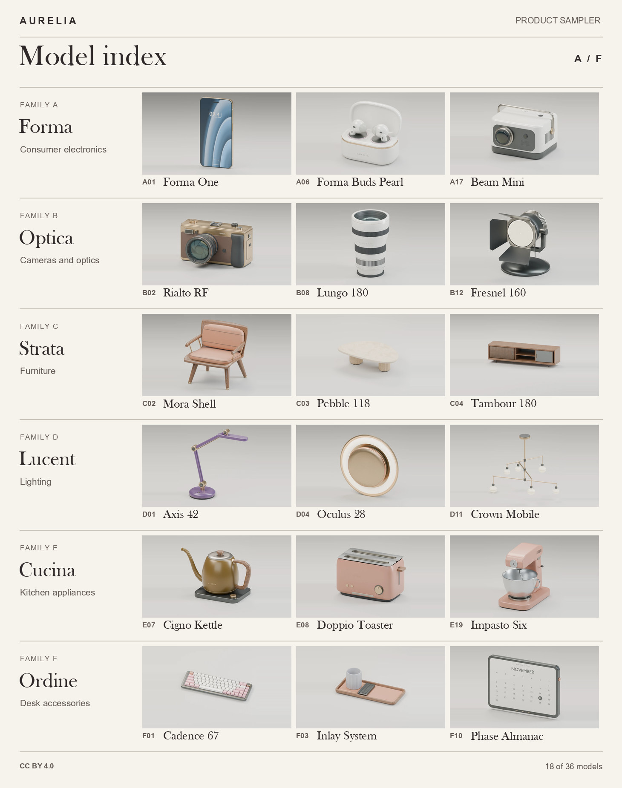
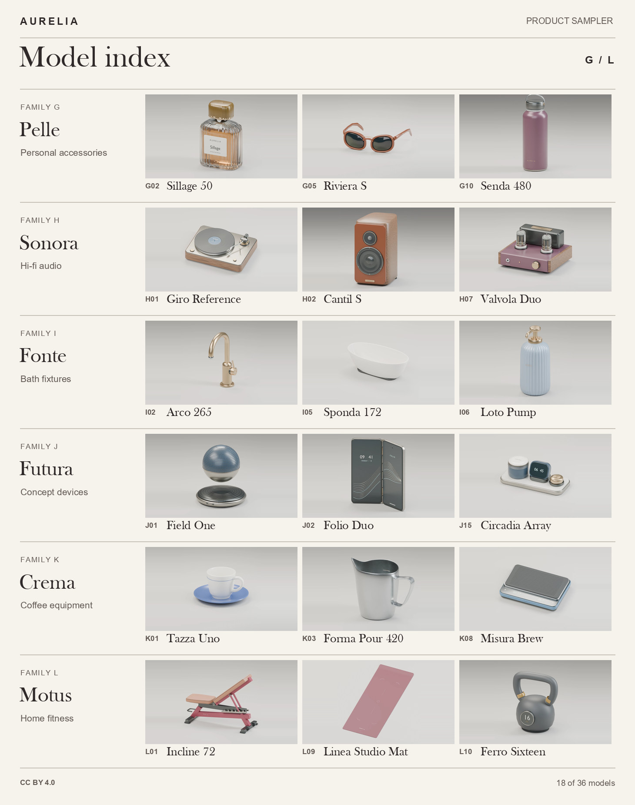

# AURELIA · Product Samples

36 editable product models and two studio scenes from the AURELIA industrial design collection. The twelve product families span a rangefinder camera, a walnut turntable, a pour-over vessel and an adjustable training bench. Each product comes as a native Blender file, a portable GLB and a studio render. The two scenes bring six of the products together in a coffee bar and a home gym.

[Download all 13 packs](https://github.com/SparkUiX/aurelia-product-samples/releases/download/v1.0.0/AURELIA-Product-Samples-1.0.zip) · [Browse the release](https://github.com/SparkUiX/aurelia-product-samples/releases/tag/v1.0.0)

## Download by family

| Family | Category | Included designs | Download |
| --- | --- | --- | --- |
| Forma | Consumer electronics | A01 Forma One, A06 Forma Buds Pearl, A17 Beam Mini | [Forma ZIP](https://github.com/SparkUiX/aurelia-product-samples/releases/download/v1.0.0/AURELIA_A_Forma_Samples.zip) |
| Optica | Cameras and studio equipment | B02 Rialto RF, B08 Lungo 180, B12 Fresnel 160 | [Optica ZIP](https://github.com/SparkUiX/aurelia-product-samples/releases/download/v1.0.0/AURELIA_B_Optica_Samples.zip) |
| Strata | Furniture | C02 Mora Shell, C03 Pebble 118, C04 Tambour 180 | [Strata ZIP](https://github.com/SparkUiX/aurelia-product-samples/releases/download/v1.0.0/AURELIA_C_Strata_Samples.zip) |
| Lucent | Architectural lighting | D01 Axis 42, D04 Oculus 28, D11 Crown Mobile | [Lucent ZIP](https://github.com/SparkUiX/aurelia-product-samples/releases/download/v1.0.0/AURELIA_D_Lucent_Samples.zip) |
| Cucina | Kitchen and home appliances | E07 Cigno Kettle, E08 Doppio Toaster, E19 Impasto Six | [Cucina ZIP](https://github.com/SparkUiX/aurelia-product-samples/releases/download/v1.0.0/AURELIA_E_Cucina_Samples.zip) |
| Ordine | Office and desk accessories | F01 Cadence 67, F03 Inlay System, F10 Phase Almanac | [Ordine ZIP](https://github.com/SparkUiX/aurelia-product-samples/releases/download/v1.0.0/AURELIA_F_Ordine_Samples.zip) |
| Pelle | Personal accessories and travel | G02 Sillage 50, G05 Riviera S, G10 Senda 480 | [Pelle ZIP](https://github.com/SparkUiX/aurelia-product-samples/releases/download/v1.0.0/AURELIA_G_Pelle_Samples.zip) |
| Sonora | Hi-fi and recording | H01 Giro Reference, H02 Cantil S, H07 Valvola Duo | [Sonora ZIP](https://github.com/SparkUiX/aurelia-product-samples/releases/download/v1.0.0/AURELIA_H_Sonora_Samples.zip) |
| Fonte | Bathroom and spa fixtures | I02 Arco 265, I05 Sponda 172, I06 Loto Pump | [Fonte ZIP](https://github.com/SparkUiX/aurelia-product-samples/releases/download/v1.0.0/AURELIA_I_Fonte_Samples.zip) |
| Futura | Near-future home technology | J01 Field One, J02 Folio Duo, J15 Circadia Array | [Futura ZIP](https://github.com/SparkUiX/aurelia-product-samples/releases/download/v1.0.0/AURELIA_J_Futura_Samples.zip) |
| Crema | Coffee bar accessories | K01 Tazza Uno, K03 Forma Pour 420, K08 Misura Brew | [Crema ZIP](https://github.com/SparkUiX/aurelia-product-samples/releases/download/v1.0.0/AURELIA_K_Crema_Samples.zip) |
| Motus | Home fitness | L01 Incline 72, L09 Linea Studio Mat, L10 Ferro Sixteen | [Motus ZIP](https://github.com/SparkUiX/aurelia-product-samples/releases/download/v1.0.0/AURELIA_L_Motus_Samples.zip) |
| Showcases | Studio scenes | Crema · Tasting Counter, Motus · Training Bay | [Showcases ZIP](https://github.com/SparkUiX/aurelia-product-samples/releases/download/v1.0.0/AURELIA_Showcases_Samples.zip) |

## Using the files

Extract the category ZIP you want. Open a product’s `.blend` in Blender 5.3 to edit its objects, modifiers and native materials. Use its `.glb` to bring the model into a compatible 3D viewer or engine. The studio renders show the native Blender materials and lighting. The Showcases ZIP includes two ready-to-render Blender scenes with cameras and lights.

To verify an individual category archive, match its SHA-256 digest against [SHA256SUMS.txt](https://github.com/SparkUiX/aurelia-product-samples/releases/download/v1.0.0/SHA256SUMS.txt). The all-in-one download contains the same 13 category archives, the license and a checksum list.

## Product index

## License and attribution

The models, scenes and preview images in this sample release are licensed under [Creative Commons Attribution 4.0 International](https://creativecommons.org/licenses/by/4.0/). You may share or adapt them, including commercially. Credit AURELIA, link to the license and identify any changes you make. [Full license text](LICENSE.txt).

Suggested credit:

> AURELIA Product Samples by AURELIA (https://github.com/SparkUiX/aurelia-product-samples), licensed under CC BY 4.0 (https://creativecommons.org/licenses/by/4.0/).

## Production

AURELIA used LLM-assisted Python scripting in Blender to construct the geometry and assemble the materials, lighting and cameras. The product and scene images are renders of the supplied 3D assets.
